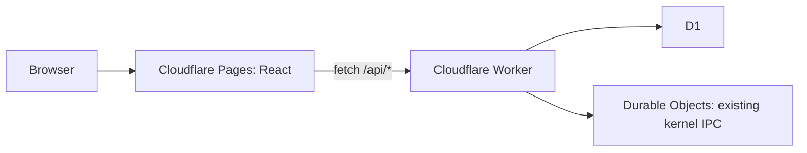

# Pages and Worker boundary

The original endpoint shapes below remain available behind staff authorisation.
See [MAX ecosystem implementation](07_MAX_ECOSYSTEM.md) for the current access
boundary, separate public API, marketplace and version-2 release workflow.

The ICVS cognitive bridge remains in `icvs/index.ts`. The automation layer coordinates the existing factory actor and uses MAX-CORE's existing simulation API unchanged. See [ICVS automation](06_ICVS_AUTOMATION.md) for the current engine, execution and recovery contracts. Build and QA require a trusted executor binding; publishing is outside this lifecycle.

## API

All responses are JSON. New endpoints return 404 for unknown routes or IDs, 405 for unsupported methods, and generic 500 errors if storage fails. Legacy `/api/kernel/*` behavior and root status are preserved, behind the same staff authorisation and exact-origin CORS policy. The existing recovery and ICVS ingestion URLs in the Dart client are still placeholders in the kernel and are not implemented by this change.

| Endpoint                          | Response                                                                              |
| --------------------------------- | ------------------------------------------------------------------------------------- |
| `GET /api/dashboard`              | `{ projects, activeProducts, readyToPublish, approvals, health }`                     |
| `GET /api/products`               | Array of products                                                                     |
| `GET /api/products/:id`           | One product, or 404                                                                   |
| `GET /api/portfolio`              | Products ranked by score, highest first                                               |
| `GET /api/pipeline`               | Array of `{ stage, products }` covering automation and preserved legacy stages |
| `GET /api/approvals`              | Pending `{ id, productId, project, action, priority, risk, status }` records          |
| `POST /api/approvals/:id/approve` | `{ success: true, status: "approved" }`                                               |
| `POST /api/approvals/:id/reject`  | `{ success: true, status: "rejected" }`                                               |
| `GET /api/analytics`              | `{ stage, count, averageScore }[]`                                                    |
| `GET /api/telemetry`              | `{ state, count }[]` from virtual processes                                           |
| `GET /api/governance`             | `{ status, count }[]` from approval history                                           |

Product fields: `id`, `name`, `description`, `stage`, `score` (0–100), `updatedAt` (SQLite UTC timestamp), `divisionId`, `revenue` (monthly USD), and `status` (On track, Attention, Paused). Stages: Idea, Discovery, Specification, Architecture, Simulation, Build, QA, Test, Package, Ready, Published; legacy Validation, Live and Archived remain supported. Active products means Live or Published; ready to publish means Ready. Process health is the rounded percentage of READY, RUNNING, and SUSPENDED processes among all stored processes. It is `null` when there are none. This measures stored process states, not a live heartbeat or infrastructure SLA.

Decision requests require `Authorization: Bearer <GOVERNOR_API_TOKEN>`. Missing server configuration returns 503; invalid authorization returns 401. Decisions atomically update only pending requests; a second decision returns 409, a nonexistent ID returns 404. Changes persist in D1. SQL values are parameterized. The API accepts validated new product intake and division creation; it does not accept arbitrary product edits.

The new API allows browser origins listed in comma-separated `ALLOWED_ORIGINS`. Configure exact scheme/host/port values. OPTIONS permits Content-Type and Authorization. Disallowed browser origins receive 403. CORS is not authentication; non-browser clients must also provide staff credentials for operational routes. API responses use `Cache-Control: no-store`.

## Cloudflare deployment

1. Confirm the existing D1 database ID and Durable Object namespace in `wrangler.toml` belong to the intended account. The `v1` actor migration and class name are preserved. Do not recreate them for an existing deployment.
2. Add the exact deployed Pages/custom origins to `ALLOWED_ORIGINS` in `wrangler.toml`. Add individual preview origins when needed; wildcard subdomains are not interpreted.
3. Apply migrations with `npx wrangler d1 migrations apply DB --remote`. Migration 0001 uses the existing kernel schema with `IF NOT EXISTS`; 0002 adds products and approvals. Existing kernel rows remain intact. Do not run the demo seed remotely.
4. Set the Worker secret with `npx wrangler secret put GOVERNOR_API_TOKEN` and deploy with `npm run deploy:worker`.
5. Create a Cloudflare Pages project connected to this monorepo. Set root directory to the repository root, build command `npm ci && npm run build`, output directory `apps/pages/dist`, and Node version 24 (or 22.12+).
6. Set **Pages build variable** `VITE_API_URL=https://portal-os1.maxjurreau.workers.dev` for production and the intended API origin for previews. Rebuild after changing it. No secrets belong in Pages `VITE_` variables.
7. Alternatively run `npm run deploy:pages` after authenticating Wrangler and configuring the build variable in the local build environment. Pages' default SPA fallback handles direct links; no top-level `404.html` is emitted.
8. Populate real product and approval data through trusted backend integrations. Empty production tables display empty states. The optional seed is synthetic local data only.

The pre-existing workflow under `github/workflows/` is not an active GitHub Actions path. This implementation documents explicit deployment commands rather than enabling automatic production deployment. Run type checks, tests and build before deployment. Cloudflare pricing and account quotas must be checked against actual usage; this structure cannot guarantee a zero-dollar bill.

## Command centre extensions

| Endpoint                              | Contract                                                                                                                                                                          |
| ------------------------------------- | --------------------------------------------------------------------------------------------------------------------------------------------------------------------------------- |
| `GET /api/divisions`                  | Registered `{id,name,color}[]`                                                                                                                                                    |
| `POST /api/divisions`                 | Authenticated `{name}`; creates a future division, duplicate name returns 409                                                                                                     |
| `POST /api/intake`                    | Authenticated `{name,description,divisionId}`; creates an Idea and activity in one D1 transaction and automatically starts durable processing                                                                                 |
| `GET /api/overview`                   | Average portfolio score, revenue, build queue, flags and published counts                                                                                                         |
| `GET /api/runtime`                    | `{processes,sampledAt,source}`; stored kernel states                                                                                                                              |
| `GET /api/processes`                  | Stored process IDs, owners, states and last heartbeat epochs                                                                                                                      |
| `GET /api/system-health`              | Worker/D1 read health, binding configuration, and stored process summary                                                                                                          |
| `GET /api/deployments`                | Latest 20 trusted deployment reports; empty until integrated                                                                                                                      |
| `GET /api/activity`                   | Latest 30 intake/planning operational events                                                                                                                                      |
| `GET /api/forecasts`                  | Division revenue and explicit −5%/0%/+10% one-month scenarios; UI compounds assumptions over a chosen horizon                                                                     |
| `GET /api/recommendations`            | Rules flag Attention, Ready, and high-scoring non-live products                                                                                                                   |
| `GET /api/departments`                | Eight department queues, KPIs, health flags and recorded outputs                                                                                                                  |
| `POST /api/approvals/:id/override`    | Authenticated `{reason}` (10–1000 characters); atomically finalizes a pending request as overridden; does not reverse prior decisions or publish                                  |
| `GET /api/decisions`                  | Latest 50 finalized decisions including override reasons                                                                                                                          |
| `GET /api/factory`                    | Latest 100 persisted automation runs                                                                                                                                                |
| `POST /api/factory/:productId/run`    | Authenticated compatibility entry point; starts durable automation from Idea/Discovery/Validation (201 new, 200 reused); invalid stage 409, insufficient brief 422 |
| `GET /api/factory/:productId/outputs` | Persisted planning outputs (JSON text) ordered by creation                                                                                                                        |

All writes retain the existing governor authorization and validation. Automated runs use the same existing actor and D1; the governor no longer starts planning from the dashboard. Refer to [the ICVS contract](06_ICVS_AUTOMATION.md) for atomic projections, retry behavior, scoring, auditability and execution requirements. Apply migrations through 0005 before deployment. Keep all existing DO migrations and bindings.
