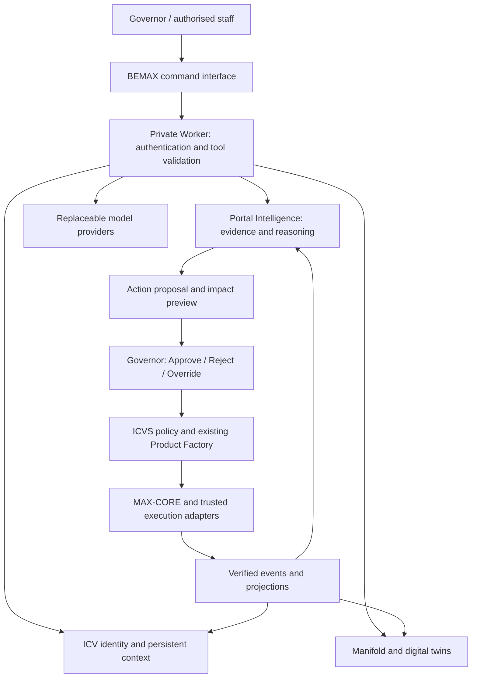

# BEMAX AI Operating System

## Portal-OS1 V2 → V3 implementation blueprint

**Status: proposed implementation.** This README defines the target contracts, delivery phases and acceptance gates; it does not claim that V3 routes, persistence or AI providers are deployed. The accompanying [acceptance specification](acceptance.feature) contains scenarios to automate during implementation.

BEMAX is the personal AI operating system for the MAX Universe: an interaction, memory, reasoning, navigation and orchestration layer within Portal-OS1. Conversation connects ecosystem intelligence to governed action.

> **Identity:** ICV · **Relationships:** Manifold · **Operations:** ICVS · **Execution:** MAX-CORE · **Authority:** Governor

## 1. Mission and boundaries

Move the primary experience from **User → Dashboard → Clicks → Reports** to **User → BEMAX → Conversation → Intelligence → Action**.

Preserve Portal-OS1, ICVS, MAX-CORE, Marketplace and Product Factory. Keep their existing APIs, stored history, workflow versions and operational screens available throughout migration. BEMAX consumes their capabilities through typed interfaces.

The [architecture authority](../PORTAL_OS1_ARCHITECTURE_AUTHORITY.md) remains binding. In particular:

- Human lifecycle decisions remain Approve, Reject and Override; only the Governor decides.
- Models propose structured intents. Backend policy checks permissions, evidence and current state before any action.
- MAX-CORE remains the shared state, event, runtime, simulation, storage and adapter foundation.
- Missing telemetry, execution evidence or providers produces an explicit unknown or blocked state.
- The public Marketplace never serves private operational APIs or conversation data.

### Baseline and intentional changes

The [V2 guide](../08_MAX_UNIVERSE_V2.md) describes the current contracts. Existing foundations include `/api/ecosystem`, intelligence forecasts, product twins, graph/topology, daily snapshots, execution monitoring and XR scene projections. These are descriptive calculations and scenarios, not trained predictions.

| V2 contract                                                                             | Proposed V3 change                                                                        | Compatibility requirement                                                                                |
| --------------------------------------------------------------------------------------- | ----------------------------------------------------------------------------------------- | -------------------------------------------------------------------------------------------------------- |
| Governor enters `/portal/governor`; other staff enter `/portal/ecosystem`               | Eligible staff enter `/portal/bemax` after rollout                                        | Keep original routes and restore role defaults when the feature is disabled                              |
| `protectPortal` restricts non-GET staff requests to Governor                            | Allow authenticated staff to create their own conversations/messages only                 | Explicit route/method allowlist plus ownership checks; no blanket relaxation of mutation policy          |
| Graph includes products, divisions, factory projects, departments, stages and approvals | Add strategies, goals, forecasts, risks, marketplace and scoped user identities           | Preserve kind-prefixed IDs and existing graph responses; use new versioned projections                   |
| Product twins and derived relationships                                                 | Generalised twins and persistent identity/context                                         | Existing tables remain authoritative; new records reference their stable IDs                             |
| Approval records refer to products                                                      | Add proposal links; introduce typed non-product approvals only in a later gated migration | Never create fake products to fit approval foreign keys; preserve existing approval routes and semantics |

The expanded conversation permissions and default entry point are deliberate V3 changes. Identity administration, arbitrary resource writes and published-release rollback require separate policies before activation.

## 2. Architecture and implementation ownership



| Location                         | Planned responsibility                                                                                |
| -------------------------------- | ----------------------------------------------------------------------------------------------------- |
| `apps/pages/src/pages/Bemax.tsx` | Command workspace, conversation, evidence inspection and accessible graph navigation                  |
| `apps/pages/src/api/`            | Typed BEMAX clients using existing staff authentication                                               |
| `apps/worker/src/bemax/`         | Transport, retrieval, conversation orchestration, provider adapters, monitoring and durable jobs      |
| `portal-os/`                     | Shared deterministic portfolio, resource, risk, forecast, dependency, strategy and decision reasoning |
| `icvs/`                          | Reuse lifecycle and approval policy; migrate existing Worker policy only with compatibility tests     |
| `apps/worker/d1/migrations/`     | Additive identity, memory, evidence and proposal migrations                                           |
| `max-core/`                      | Existing foundation; no duplicate engine or breaking interface changes                                |

Use D1 for durable queryable records and existing Durable Object scheduling/admission mechanisms where needed. A search or embedding index is optional and rebuildable; it is never the sole copy of identity or memory. Do not introduce another factory execution system.

## 3. Command experience

`/portal/bemax` is the primary command workspace. Desktop layout gives conversation the main column, a selectable Universe Map alongside it, and contextual operational panels. On small screens, panels become accessible tabs with a relationship table alternative to the graph.

Required panels: **Conversation, Universe Map, Approvals, Recommendations, Alerts, Forecasts, Portfolio, Recent Decisions and Activity Stream**. Panels share scope and an explicit snapshot timestamp; stale or failed panels identify themselves. Governor-only decisions remain hidden from other roles and enforced on the server. Recent Decisions follows the existing Governor restriction on `/api/decisions`.

Each answer can expose evidence cards, an entity link, a forecast scenario or an action proposal. A proposal opens an impact preview and Governor controls. A conversational “approve” resolves a specific pending proposal and opens confirmation; ambiguous references require clarification. Text alone never bypasses the decision gate.

| Example request                               | Required result                                                           |
| --------------------------------------------- | ------------------------------------------------------------------------- |
| Show me ecosystem health.                     | Health summary with source timestamps and unknown coverage                |
| Show me products at risk.                     | Ranked risks, affected products, observed flags and dependency paths      |
| Show me publishing candidates.                | Verified readiness, package/QA evidence and outstanding approval gates    |
| What should I focus on next?                  | Next best action, rationale, alternatives and tradeoffs                   |
| Which division needs attention?               | Comparable division metrics with missing-data coverage                    |
| What is slowing growth?                       | Observed bottlenecks; hypotheses labelled separately from measured causes |
| What opportunities exist?                     | Investment and promotion candidates with supporting metrics               |
| Why was this recommendation made?             | Persisted evidence, rule/model version and assumptions used at creation   |
| How will approving this affect the ecosystem? | Before/after scenario, affected relationships, costs and uncertainty      |

All panels need loading, empty, stale, blocked, error and retry states. Support keyboard navigation, focus restoration, screen-reader announcements and reduced motion. Use British English in product copy.

## 4. ICV: identity persistence

Identity Curvature Vector is the versioned identity and decision-context contract. “Vector” does not imply an invented mathematical score or a required embedding. Any later numerical representation needs a documented method and independent validation.

ICV answers four questions:

| Question            | Stored context                                                  |
| ------------------- | --------------------------------------------------------------- |
| What am I?          | Stable identity, entity kind, mission, owner and scope          |
| What am I managing? | Portfolio membership, relationships, goals and responsibilities |
| What changed?       | Ordered source events and linked prior revisions                |
| What matters?       | Active strategies, constraints, priorities and decision anchors |

Track products, divisions, projects, strategies, goals, relationships, decisions and history. Identity survives renaming, UI changes and provider replacement. Factory projects reference existing factory run IDs. Revisions retain provenance and effective times; current state is a projection, not an overwritten history.

### Persistent memory

Store portfolio, project, product, forecast, approval, strategy, conversation, recommendation and historical context. Retrieval is scoped to the authenticated actor and authorised resources before ranking or model access. Personal conversations remain owner-only unless an explicit sharing policy is implemented. Governors do not gain implicit access to another staff member's private conversation.

Memory distinguishes **source fact**, **human decision**, **model inference** and **conversation summary**. Summaries reference original messages and cannot turn speculation into a fact. Corrections supersede earlier memories without rewriting decisions. Previous forecasts remain immutable so later observations can be compared with their original assumptions.

Configure retention by record class before production: conversation content may expire or be redacted according to policy; decision audit metadata follows the required audit retention. Deletion must propagate to summaries and derived indexes. Credentials and unrestricted raw customer records never enter model context.

## 5. Manifold and digital twins

The Manifold is a navigable projection of authoritative entities and relationships. It represents MAX Games, MAX Apps, MAX Media, MAX Art, MAX Institute, MAX Sports and Quantum XR, plus projects, products, departments, dependencies, risks and forecasts. Resolve divisions from stored records; do not manufacture operational data for an absent division. Add MAX Sports through the supported division mechanism during the migration if absent.

Every twin exposes **identity, state, history, forecast, relationships, health, risk and recommendations**, each with timestamps and provenance. Unknown fields are explicit. Include product, project, division, department, marketplace and user kinds. User twins use minimal scoped staff identity metadata; public customer accounts retain their existing isolation and ownership rules.

Preserve existing `product:`, `project:`, `division:`, `department:`, `pipeline:` and `approval:` IDs. Add namespaced kinds without re-keying existing nodes. Relationship types include `belongs_to`, `depends_on`, `integrates_with`, `supports_goal`, `constrained_by`, `forecast_for` and `requires_decision`. Direction, source, validity period and retirement reason are recorded. Traversal is cycle-safe, depth-bounded and permission-filtered; edges must not reveal hidden nodes.

## 6. Proposed data schemas

These are implementation contracts, not runnable migrations. Reserve migration numbers only when implementing; `0007` is the current baseline. All new tables need foreign keys, indexes, runtime validation and migration tests.

Common conventions: opaque stable IDs, UTC ISO-8601 timestamps, integer revisions, validated JSON with a schema version, explicit `null` for unknown values. A `scope_id` identifies the authorised ecosystem, not a caller-supplied permission grant. Internal jobs derive scope from trusted configuration. Authorisation is checked on reads and writes.

| Proposed table          | Core fields                                                                                                                                                                               | Constraints / indexes                                                                                         |
| ----------------------- | ----------------------------------------------------------------------------------------------------------------------------------------------------------------------------------------- | ------------------------------------------------------------------------------------------------------------- |
| `bemax_entities`        | `id`, `scope_id`, `kind`, `source_system`, `source_id`, `created_at`, `retired_at`                                                                                                        | PK `id`; unique `(scope_id, source_system, kind, source_id)`; source record must exist                        |
| `bemax_icv_revisions`   | `entity_id`, `revision`, `mission`, `context_json`, `source_event_id`, `effective_at`                                                                                                     | PK `(entity_id, revision)`; FK entity; immutable; context contains goals, constraints and decision references |
| `bemax_events`          | `id`, `scope_id`, `entity_id`, `source`, `source_event_key`, `type`, `payload_json`, `observed_at`, `recorded_at`                                                                         | Unique `(scope_id, source, source_event_key)` for replay; entity/time index                                   |
| `bemax_conversations`   | `id`, `scope_id`, `owner_actor_id`, `title`, `created_at`, `retention_until`                                                                                                              | Owner/scope/time index; owner derived from authentication                                                     |
| `bemax_messages`        | `id`, `conversation_id`, `sequence`, `role`, `content`, `request_key`, `created_at`                                                                                                       | FK conversation; unique sequence and request key per conversation; role restricted to user/assistant/tool     |
| `bemax_memories`        | `id`, `scope_id`, `owner_actor_id`, `entity_id`, `conversation_id`, `kind`, `content_json`, `source_refs_json`, `supersedes_id`, `expires_at`                                             | Validate visibility and provenance; FK references; scope/entity/expiry index                                  |
| `bemax_edges`           | `id`, `scope_id`, `source_entity_id`, `target_entity_id`, `relation`, `provenance_json`, `valid_from`, `retired_at`                                                                       | Entity FKs; index both directions; unique active sourced relationship; no duplicate V2 edge ownership         |
| `bemax_recommendations` | `id`, `scope_id`, `entity_id`, `category`, `statement`, `evidence_json`, `metrics_json`, `confidence_json`, `tradeoffs_json`, `method_version`, `snapshot_id`, `created_at`, `expires_at` | Immutable evidence snapshot; evidence and tradeoffs required; scope/category/time index                       |
| `bemax_forecasts`       | `id`, `scope_id`, `entity_id`, `kind`, `horizon_json`, `assumptions_json`, `result_json`, `method_version`, `evidence_json`, `created_at`                                                 | Immutable; kinds capacity/growth/revenue/system; unit/currency explicit                                       |
| `bemax_proposals`       | `id`, `scope_id`, `recommendation_id`, `action`, `target_entity_id`, `expected_revision`, `impact_json`, `payload_hash`, `status`, `expires_at`, `created_at`                             | Action allowlist; FK target; immutable payload; compare-and-set state transitions                             |
| `bemax_approval_links`  | `proposal_id`, `approval_id`                                                                                                                                                              | Unique FKs to proposal and existing product approval; non-product gates require later typed approval schema   |
| `bemax_jobs`            | `id`, `scope_id`, `proposal_id`, `kind`, `idempotency_key`, `status`, `attempts`, `lease_until`, `evidence_json`, `updated_at`                                                            | Unique idempotency key; due/status index; existing factory operations remain in their current tables          |
| `bemax_monitor_runs`    | `id`, `scope_id`, `window_key`, `status`, `snapshot_id`, `summary_ref`, `error_code`, `created_at`                                                                                        | Unique scope/window; resumable reconciliation; no fabricated success                                          |

Snapshot IDs reference persisted source event/revision sets, including observed values and timestamps. They must be resolvable after current projections change. JSON evidence is validated against the contract below; copying an endpoint URL alone is insufficient historical evidence.

```ts
// Proposed provider-independent response contract.
interface Evidence {
  entityId: string;
  source: string; // authorised internal source, not a model-invented URL
  sourceRevision: string;
  observedAt: string;
  metric: string;
  value: number | string | null;
  unit: string | null;
}
interface Recommendation {
  schemaVersion: 1;
  id: string;
  category:
    | "next_action"
    | "risk"
    | "opportunity"
    | "investment"
    | "promotion"
    | "archive";
  statement: string;
  evidence: Evidence[];
  supportingMetrics: Evidence[];
  confidence: {
    level: "low" | "medium" | "high" | "unknown";
    basis: string;
    coverage: number | null; // 0..1 source coverage, not probability of success
  };
  tradeoffs: { benefit: string; cost: string; alternative: string }[];
  method: { kind: "rule" | "model"; version: string; provider: string | null };
  assumptions: string[];
  snapshotId: string;
  createdAt: string;
  expiresAt: string;
}
```

Recommendations without supporting evidence are withheld and reported as insufficient data. Risk points remain triage heuristics. Revenue scenarios retain monthly USD reported revenue separately from marketplace settlements by currency. Capacity and system forecasts disclose service availability, backlog, completion-rate assumptions and horizon; insufficient history yields unknown.

## 7. Proposed routes and API contracts

All BEMAX routes live on the private portal. Existing V2 routes remain unchanged. New responses use `schemaVersion: 1`, `requestId`, `sampledAt` and `Cache-Control: no-store`. Collections return `{items, nextCursor}` with stable ordering and a maximum page size of 100. Existing V2 source limits remain in force until explicit partitioning is implemented; never silently analyse a truncated portfolio.

| Method and route                             | Purpose / access                                                                                              |
| -------------------------------------------- | ------------------------------------------------------------------------------------------------------------- |
| `GET /portal/bemax`                          | Staff command workspace, gated by rollout flag                                                                |
| `GET /portal/bemax/conversations/:id`        | Owner's persisted conversation                                                                                |
| `GET /portal/bemax/entities/:entityId`       | Authorised entity twin and evidence                                                                           |
| `GET /api/bemax/context`                     | Staff capabilities, scope, identity summary and freshness                                                     |
| `POST /api/bemax/conversations`              | Staff creates own conversation; body `{title?}`                                                               |
| `GET /api/bemax/conversations`               | List caller's conversations                                                                                   |
| `GET /api/bemax/conversations/:id/messages`  | Owner-only paginated history                                                                                  |
| `POST /api/bemax/conversations/:id/messages` | Owner submits `{text, entityIds?, expectedSequence}` with `Idempotency-Key`; returns `202 {messageId, jobId}` |
| `GET /api/bemax/jobs/:id`                    | Authorised job state and resulting answer/proposal references                                                 |
| `GET /api/bemax/memories?entityId=…`         | Visible memory with provenance; never cross-owner retrieval                                                   |
| `GET /api/bemax/entities/:entityId`          | Generalised digital twin and ICV revision                                                                     |
| `GET /api/bemax/manifold?root=…&depth=2`     | Versioned graph, depth 0–4, cursor and completeness metadata                                                  |
| `GET /api/bemax/recommendations`             | Evidence-backed recommendations filtered by category/entity                                                   |
| `GET /api/bemax/recommendations/:id`         | Original evidence, metrics, confidence and tradeoffs                                                          |
| `GET /api/bemax/forecasts`                   | Persisted scenarios and assumptions                                                                           |
| `GET /api/bemax/alerts`                      | Deduplicated anomalies, freshness and acknowledgement state                                                   |
| `GET /api/bemax/activity`                    | Scope-filtered events; Governor-only decision details                                                         |
| `GET /api/bemax/proposals/:id`               | Governor impact preview, expected state and approval reference                                                |
| `POST /api/approvals/:id/approve`            | Existing Governor decision route; preserve current body contract                                              |
| `POST /api/approvals/:id/reject`             | Existing Governor decision route; preserve current body contract                                              |
| `POST /api/approvals/:id/override`           | Existing Governor decision route with required reason                                                         |

Proposals, forecasts and reports are created by validated internal orchestration tools from conversation intents or monitor runs. There is no arbitrary browser endpoint for changing lifecycle state. Product proposal decisions resolve through existing approval routes; adapter changes must atomically validate the linked proposal's expiry, payload hash and expected revision before finalisation. Do not change unrelated legacy approval requests.

HTTP errors: 400 invalid input, 401 unauthenticated, 403 forbidden, 404 absent or inaccessible owner-scoped resource, 409 revision/idempotency conflict, 413 oversized request or source bound, 429 rate limit, 503 required capability unavailable. Errors include a stable code and safe message. Message bodies are capped at 16 KiB, text at 8,000 characters and entity context at 20 IDs. Reject unknown action/tool fields. Identical idempotent retries return the original result; changed payload under the same key returns 409.

## 8. Reasoning, providers and orchestration

Reasoning combines portfolio, resource, risk, forecast, dependency, strategy and decision analysis. Deterministic calculations remain in Portal Intelligence. Providers interpret language and explain bounded evidence; they cannot create trusted observations.

```ts
interface BemaxProvider {
  id: string;
  capabilities: {
    structuredOutput: boolean;
    streaming: boolean;
    toolCalls: boolean;
  };
  generate(input: {
    messages: { role: "system" | "user" | "assistant"; content: string }[];
    evidence: Evidence[];
    allowedTools: string[];
    deadlineMs: number;
    maxOutputTokens: number;
    requestId: string;
  }): Promise<{
    text: string;
    intents: { tool: string; arguments: unknown }[];
    usage: { inputTokens: number; outputTokens: number } | null;
    model: string;
  }>;
}
```

Implement adapters for OpenAI, Google Gemini, Anthropic Claude, local models and future MAX models behind this interface. Select provider/model through server configuration, capability checks and approved data-routing policy. Provider keys stay server-side. Persist provider/model and prompt-policy versions for traceability; store only necessary content and redact secrets.

Validate provider output independently. Treat retrieved text as data, never as authority to approve or call a tool. Allowlist tools such as `read_ecosystem`, `read_twin`, `explain_recommendation`, `navigate`, `propose_action`, `generate_report` and `create_forecast`. Each has a schema, resource authorisation, time budget and audit event. Navigation returns only allowlisted local routes.

Use bounded retries, cancellation, token/cost ceilings and circuit breakers. Fallback providers require the same approved data policy; never silently send context to an unapproved vendor. When models fail, deterministic health, graph, forecasts and evidence remain available with a visible degraded status.

### Action lifecycle

`proposed → pending_approval → approved | rejected | expired → queued → running → succeeded | blocked | failed`

Only `approved` can proceed to `queued`. Rejected and expired proposals never execute. Override is an audited decision mode with a reason, subject to existing policy; it cannot rewrite a final decision or fabricate evidence. A stale proposal requires a fresh impact preview and a new proposal, preserving the old record.

| Requested action                  | Execution boundary                                                                                       |
| --------------------------------- | -------------------------------------------------------------------------------------------------------- |
| Approve release                   | Link verified package and existing workflow approval; publication follows the versioned factory contract |
| Increase resources                | Require typed resource approval, capacity policy and trusted adapter before enabling                     |
| Pause project                     | Require a versioned ICVS pause/resume policy; block while unsupported                                    |
| Promote / archive product         | Reuse supported lifecycle policy and product approval; unsupported transitions remain blocked            |
| Generate report / create forecast | Persist read-derived output in caller scope; no product mutation or lifecycle approval required          |

Decisions and enqueue records must commit atomically or use a durable outbox reconciled after interruption. Reuse stable execution operation IDs and verified receipts. A transport timeout is not proof of failure or permission to repeat an external effect. Retries require an idempotent adapter. Reversing effects requires a new authorised compensation event, not deletion of history.

## 9. Monitoring and XR

Extend the existing scheduled reconciliation with independently failing BEMAX jobs. Start with a configurable five-minute monitoring window and a daily executive summary. Monitor portfolio, publishing, product health, divisions, departments, capacity, stalled dependencies and telemetry freshness. Persist the observation window and checkpoint; deduplicate alerts by entity/rule/window, suppress unchanged repeats and record resolution events.

Monitoring produces summaries, top risks, opportunities, investments, promotions, archive candidates and next actions. It may propose changes, but never approve itself. Scope every derived record and make missing sources visible. Provider outages must not stop deterministic monitors or factory reconciliation.

Preserve the current XR `schemaVersion: 1` scene contracts. Publish an opt-in versioned enrichment contract containing ICV references, evidence links, recommendation IDs and forecast references. Existing illustrative coordinates retain their documented meaning.

| Visualisation                  | Integration                                                                             |
| ------------------------------ | --------------------------------------------------------------------------------------- |
| Ecosystem Galaxy               | Existing `/api/xr/ecosystem-galaxy`                                                     |
| Product Constellation          | Existing `/api/xr/product-constellation`                                                |
| Pipeline Universe              | Existing `/api/xr/pipeline-universe`                                                    |
| Department Operations Center   | Existing `/api/xr/department-operations`                                                |
| MAX Sports Intelligence Center | Proposed `/api/xr/max-sports-intelligence-centre`, scoped to the stored Sports division |
| Quantum XR Command Room        | Existing `/api/xr/quantum-xr-command-room`                                              |

All scenes consume the same authorised Manifold and intelligence snapshots. Scene selection may create a conversational context reference; it never authorises a mutation. Headset renderers remain a separate delivery scope.

## 10. Phased V2-to-V3 migration

Sequence phases by exit evidence, not dates. Suggested owners are accountable roles, not assignments to named people.

| Phase / owner                                        | Deliverables and dependencies                                                                                                                    | Exit gate                                                                                 | Rollback                                                                            |
| ---------------------------------------------------- | ------------------------------------------------------------------------------------------------------------------------------------------------ | ----------------------------------------------------------------------------------------- | ----------------------------------------------------------------------------------- |
| 0 — Baseline / platform                              | Record V2 route/schema contracts, data counts, role matrix, backup/restore rehearsal and feature flags; agree retention and provider data policy | Existing required checks pass; compatibility fixtures include legacy and V2 runs          | No runtime change                                                                   |
| 1 — Identity and memory / backend                    | Add entity registry, ICV revisions, source events and owner-scoped memory; backfill stable references in bounded resumable batches               | No lost IDs/history; replay produces no duplicates; ownership tests pass                  | Disable projection writers; keep additive tables and audit history                  |
| 2 — Manifold and twins / intelligence                | Reuse V2 graph; add scoped entity kinds, goals/strategies and twin fields; include all configured divisions                                      | Graph parity, no dangling/hidden edges, bounded cycles; missing data stays unknown        | Serve existing V2 graph/twin routes                                                 |
| 3 — Conversation / product + backend                 | Optional `/portal/bemax`, persistent conversations, provider interface, read tools, evidence cards and degraded mode                             | Owner isolation, all nine query journeys and provider swap tests pass                     | Hide route entry; stop new jobs; retain conversations                               |
| 4 — Reasoning and monitoring / intelligence          | Persist reproducible recommendations/scenarios; scheduled summaries, anomaly detection and forecasts                                             | Provenance completeness, retry/deduplication and independent scheduler failure tests pass | Disable monitor jobs; retain V2 intelligence and persisted results                  |
| 5 — Governed actions / ICVS + platform               | Product proposal linkage, impact preview, atomic decision/outbox, trusted execution; separately gated non-product approvals                      | Authority, race, stale-state, idempotency and recovery scenarios pass                     | Stop new proposals/dispatch; reconcile running operations; preserve final decisions |
| 6 — Primary experience and XR / product + operations | Enable BEMAX by cohort, then default entry; versioned XR enrichment and Sports view                                                              | Browser/accessibility checks and production acceptance metrics below pass                 | Restore role home routes; disable enrichment; continue V2 operations                |

### Data rollout procedure

1. Back up the deployment database and verify restoration in an isolated environment. Record migration version and row counts for products, runs, approvals and decisions.
2. Apply additive migrations before enabling V3 writers. Avoid renaming or dropping existing columns and preserve Durable Object identities.
3. Backfill entity references using stable source keys and checkpoints. Do not invent past telemetry or discussions. Label imported context with its actual source and import time.
4. Catch up events created during backfill, then reconcile identities, counts, foreign keys and graph parity. Keep one authoritative writer per record type.
5. Enable shadow intelligence, compare it with V2, then enable read conversations for a small staff cohort. Activate governed actions only after phase 5 gates.
6. Increase rollout only when acceptance gates hold. Roll back flags and compatible application versions without reversing additive migrations. Drain or reconcile admitted operations; never erase decisions to make rollback appear complete.

Proposed flags: `BEMAX_ENABLED`, `BEMAX_DEFAULT_HOME`, `BEMAX_MONITORING_ENABLED`, `BEMAX_ACTIONS_ENABLED`, `BEMAX_XR_ENRICHMENT_ENABLED`. Enforce capability flags server-side as well as in navigation. Keep actions disabled by default during migration.

### Acceptance metrics for phase 6

- All nine conversational journeys return grounded answers or explicit insufficient-data results on deterministic fixtures.
- Every actionable recommendation contains evidence, sources, supporting metrics, confidence basis and tradeoffs.
- Zero cross-owner conversation disclosures, unauthorised decisions or duplicate external effects in adversarial/retry tests.
- Migration reconciliation preserves all baseline IDs and final decisions; repeated backfill adds no duplicates.
- On the agreed 5,000-record fixture, target p95 context reads under two seconds and acknowledgement under one second; measure model completion separately with a configured timeout. These are release targets, not measured results.
- Governor can inspect, propose, decide and trace the result from conversation; all existing operational routes remain usable.

## 11. Acceptance tests and release evidence

[acceptance.feature](acceptance.feature) is a Gherkin specification, not an executable test suite yet. During each phase, bind scenarios to Worker/Vitest fixtures, migration tests and browser journeys. Use fake provider adapters and synthetic data for deterministic contract tests; verify real provider adapters separately with authorised configuration.

| Coverage                          | Planned automation                                                                                                             |
| --------------------------------- | ------------------------------------------------------------------------------------------------------------------------------ |
| Query/evidence/reasoning          | Shared Portal Intelligence unit tests and private Worker API tests                                                             |
| Ownership, decisions, idempotency | Extend `apps/worker/test/api.test.ts` with role and replay fixtures                                                            |
| Schema/backfill                   | Apply complete migration chain to empty and populated V2 databases; run `PRAGMA foreign_key_check` and count/ID reconciliation |
| Provider substitution and outages | Adapter contract tests with scripted success, malformed output, timeout and rate-limit responses                               |
| Command interface                 | Cloud Chromium journeys through the task Preview, keyboard and narrow-viewport checks                                          |
| Existing integrations             | Preserve current MAX-CORE tests, marketplace isolation and factory lifecycle regression checks                                 |

Required implementation release commands from the V2 guide:

```sh
npm run typecheck
npm test
npm run build
npx wrangler deploy --dry-run
npx wrangler deploy --dry-run --config wrangler.marketplace.toml
```

Also require migration/foreign-key checks and private browser journeys. Dry runs do not establish production readiness. Record exact tested revision, fixtures, checks, blocked integrations and rollout evidence before enabling each phase.

## 12. Definition of done

Portal-OS1 opens into BEMAX for enabled users. BEMAX remembers authorised context, understands identity and relationships, explains source-backed intelligence, forecasts with explicit assumptions, navigates existing operations and proposes governed actions. The Governor retains Approve, Reject and Override authority. ICVS and MAX-CORE continue to own operations and execution; Marketplace and Product Factory continue to function through their existing boundaries.

V3 is complete only when persisted memory survives restarts, evidence remains reproducible, migrations preserve history, all acceptance gates pass and enabled execution adapters return verified results. Provider integrations, action types or XR clients that remain blocked must be reported as incomplete rather than presented as working capabilities.
